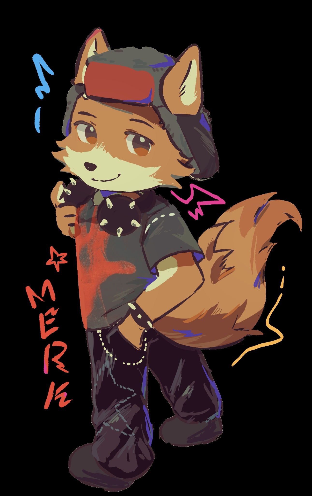

<b>Merks@DESKTOP-G8J839M</b> 
-------------------- 
<b>About:</b> My name is Marko, im an artist, editor and i have a passion for customizing shit. im a noobie on github so dont expect much 
<b>OS:</b> Windows 11 Home (Sometimes experiments with Arch)  
<b> 
<b>Host:</b> Merks :3 
<b>Terminal:</b> Windows Terminal 
<b>CPU:</b> Intel(R) Core(TM) 5 210H @ 2.688GHz 
<b>GPU:</b> NVIDIA GeForce RTX 5060 Laptop GPU 
<b>GPU:</b> Intel(R) Graphics 
<b>Memory:</b> 12.33 GiB / 15.71 GiB (78%) 
<b>Disk (C:):</b> 642 GiB / 953 GiB (67%) 
 
 
